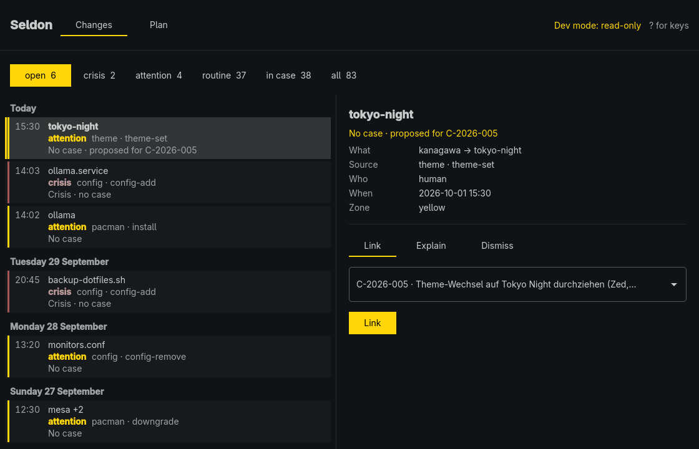
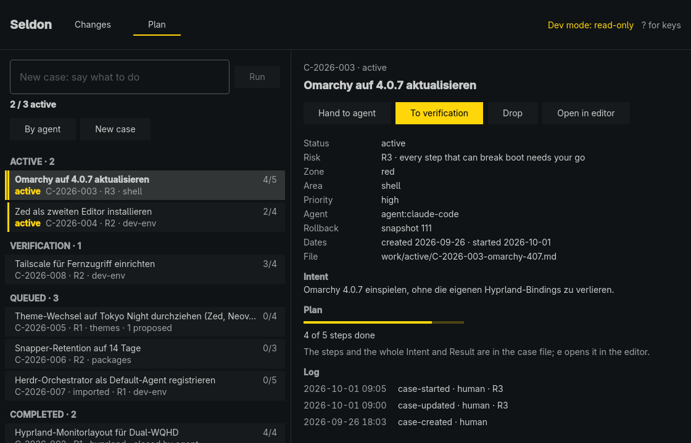

# seldon-desk

The Seldon window: what changed on your machine, who changed it, and why.
A native app for Omarchy, built the way Omarchy's own apps are (C++ and Qt
Quick, qmake6 and make, following the Omarchy theme and language live).



The app is being built view by view on the `app` branch (ADR-0056 §3):
**Changes** (WP-228: what changed, by day, and its resolution) and
**Plan** (WP-232: the cases). The engine (`seldon`) stays the only writer;
the window reads `${XDG_STATE_HOME:-~/.local/state}/seldon/index.json` and
runs `seldon … --json` with fixed argument lists, like the bar plugin
(docs/CONTRACT.md). It reuses the plugin's `Model.js` and `Tones.js`
unchanged.



**Plan** lists the cases by group (Active · Verification · Queued ·
Completed) with the WIP line ("2 / 3 active": it warns, it never blocks),
*By agent* (Completed shows only the cases an agent closed) and a search.
Beside the list is the selected case: its next steps (Start, Hand to agent
or Focus, To verification, Complete, Drop, Reopen, Open in editor), its
details, plan, log and linked changes, all from the index. A new case comes
from one sentence (the engine makes it and starts an agent on it) or by
hand (*New case*: title, zone, risk, priority, area). Every act that writes
is pressed twice: the first press says what will run, the second runs
exactly that; anything that changes it in between (another case, a new
index, another field) disarms. A refused new case keeps what was typed.
An imported case is started from the terminal, after reading its whole
Intent in the editor.

## Build and test

```sh
app/bin/build    # qmake6 + make into app/build/seldon-desk (Qt 6.9 or newer)
app/bin/test     # the Qt Test binary, offscreen, with its own HOME and runtime dir
```

Look at the sample index without touching a logbook (read-only dev mode,
CONTRACT.md rule 1):

```sh
SELDON_INDEX=fixtures/index.sample.json app/build/seldon-desk
```

`SELDON_DESK_SCREENSHOT=<file> app/bin/test windowShowsTheFixture` and
`SELDON_DESK_PLAN_SCREENSHOT=<file> app/bin/test planShowsTheFixture` write
the screenshots above from the fixture with the default accent.

## Keys

The window:

| Key | What it does |
|---|---|
| 1, 2 | Changes, Plan |
| ? | Show or hide the keys (↑ ↓ scroll them in a short window) |
| Q | Quit (asks first while a text is not sent) |

Changes:

| Key | What it does |
|---|---|
| ↑ ↓, j k | Move through the changes |
| f, F | Next or previous chip |
| Enter | Open the form of an open change; in the form, press (twice to confirm) |
| Space | Capture now, or the fix of the state shown |
| Esc | Leave the form, disarm, close the key overlay |

Plan:

| Key | What it does |
|---|---|
| ↑ ↓, j k | Move through the cases |
| Enter, Space | The case's next step: Start, To verification, Complete (twice); in New case, Create (twice) |
| a | Hand the case to an agent (twice), or Focus the agent working on it |
| x | Drop the case (twice; final) |
| r | Reopen a completed case as a new one (twice) |
| e | Open the case file in the editor |
| i | New case in one sentence: type it, Enter twice starts an agent |
| n | New case by hand (Tab between fields, ← → or h l on a choice) |
| / | Search the cases |
| b | By agent |
| Esc | Leave the field, disarm, close the form, clear the search |

Enter never starts an agent; only `a` or a click does. The filled button
on a case is the act Enter takes. A held key acts once: its repeat never
confirms what its first press armed. While the New case form is open,
`a x r e` do nothing (the case is behind the form); while the key overlay
or the quit question shows, no key acts.

## States

Each state that keeps the changes from showing has one fix: the engine
missing (Install, in Omarchy's terminal), no logbook (Create logbook, in
Omarchy's terminal), no index (Build index: `seldon status`), a stale index
(Capture now: `seldon capture`). An index of a contract the window cannot
read says so and checks again; a newer one it can still read (ADR-0051)
shows, with a quiet note to update Seldon.

A typed reason is not lost by accident: Q, or selecting another change,
asks first; the second try goes ahead, Esc stays. Drafts in Plan (the
sentence, the New case form) stay when the view changes or the form
closes, and Q asks first while one is there.

## Storage and settings

The window writes nothing itself. It reads the index, the Omarchy theme
(`~/.local/state/omarchy/current/theme/colors.toml`) and language
(`~/.config/omarchy/language`); no Omarchy config is changed.

## License

MIT. The template parts (Theme, Translator, build scripts) keep David
Heinemeier Hansson's MIT notice; see [LICENSE](LICENSE).
