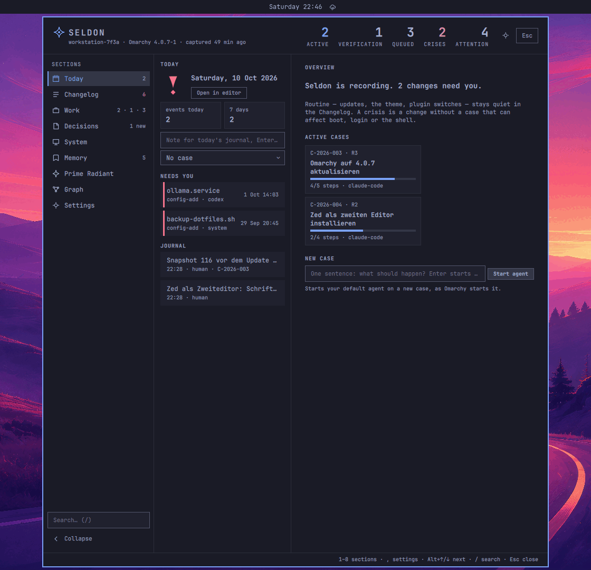
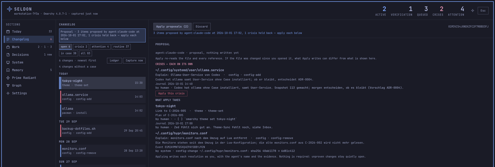
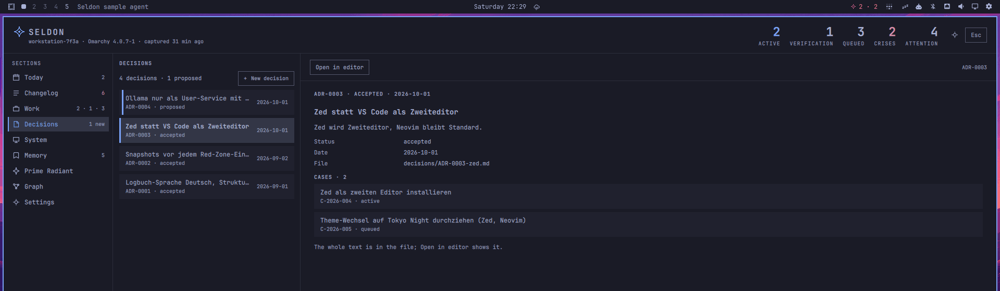
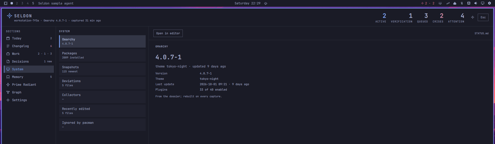
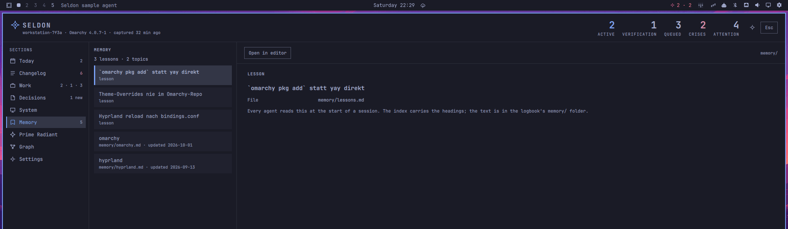
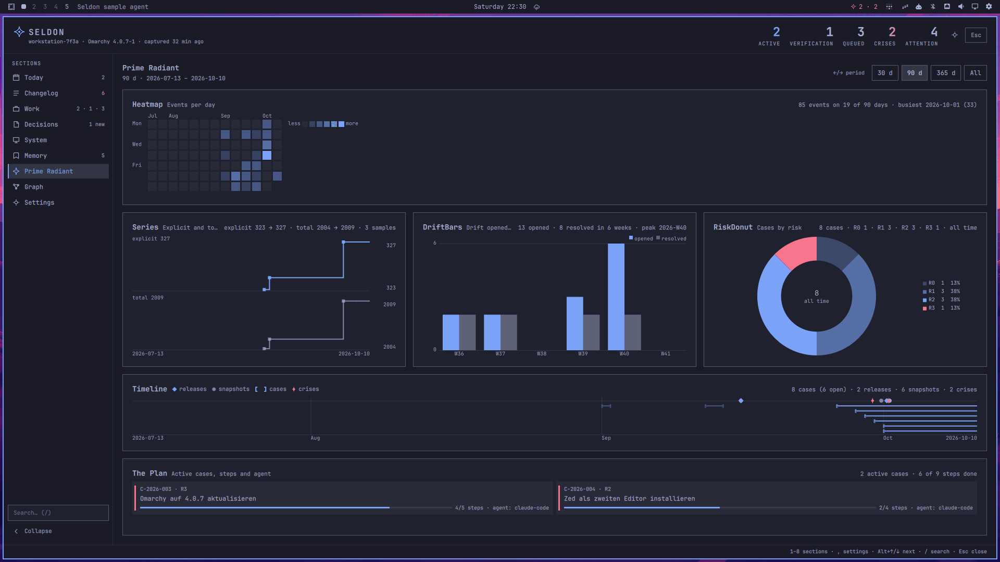
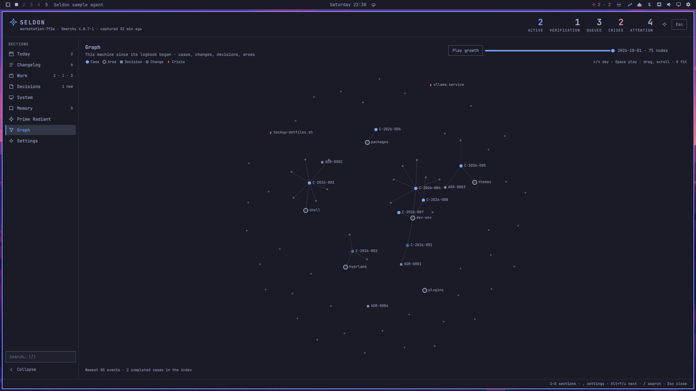
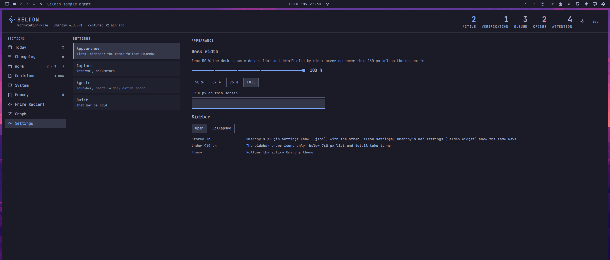

# Daily use

This page covers the parts of Seldon you see every day: the pill in the
bar and the desk it opens, with its nine sections, its keys and its
width. Everything here works with the mouse and with the keyboard.

## A day with Seldon

- In the morning, glance at the pill. The mark, then `2 · 1`, means two
  active cases and one crisis. Without a crisis the second number is
  gone.
- Before a change, create a case (`+` on the desk) and start it, or
  type one sentence into *New case* on Today and let an agent do it.
- While you work, write a note when you learn something (`n` on the
  desk).
- When the pill turns to your theme's error colour, open the desk. Today
  lists the crisis under NEEDS YOU. That is the one thing Seldon asks you
  to look at. Other changes without a case wait quietly in the
  Changelog; resolve them when you like, or let an agent sort them.
- At the end of a case, hand it to verification and complete it in
  Work.
- Once a week, open the Prime Radiant and look at the picture.

## The pill

The pill sits on the right of the bar.

- The Seldon mark, then `A · D`: A is the number of active cases, D the
  number of crises. Parts that are zero are hidden: the mark alone, `2`,
  `· 1`. The mark takes the pill's colour. Changes without a case that are
  no crisis are not counted here: the desk's header and the tooltip
  count them (*attention*, *without a case*). The setting `driftInBar`
  set to `all` counts them in the bar too (see
  [Configuration](06-configuration.md#plugin-settings)).
- It uses your theme's accent colour while cases are active, the theme's
  urgent colour when there is a crisis, and dims while something needs
  fixing.
- The tooltip says what the numbers mean, how many changes have no case,
  and when the engine last captured: "Seldon — 2 active cases, 1 crisis,
  7 changes without a case, last capture 4 min ago".

| Click | Does |
|---|---|
| Left | open or close the desk |
| Middle | open the desk at the Prime Radiant (section 7) |
| Right | capture now |

To open the desk with a key, add this line to your Hyprland bindings
(Seldon never installs it for you). `SUPER + SHIFT + L` (L for logbook)
is a suggestion that Omarchy leaves free; any free key works:

```text
o.bind("SUPER + SHIFT + L", "Seldon", "omarchy-shell shell toggle jax.seldon")
```

The desk opens on the monitor that has the focus and remembers its
section and selection until the next open. Esc, a click outside it, a
left click on the pill or the key again closes it.

## The desk


*Sample data.*

The desk is the plugin's one surface. It opens below the bar, which stays
visible above it, and it reads like an application window: nothing
behind it is dimmed. From top to bottom:

- **Header.** The Seldon mark, "SELDON" and a subline: the machine, the
  Omarchy version and "captured N ago". Then the status chip, only while
  a notice is up: the first notice's title and "+N" for more; a click
  folds the notices. Then the KPI strip: active, verification, queued,
  crises (urgent while there is one) and attention. Each figure is a
  click to its section: Work, or the Changelog filtered to the crises or
  the open changes. At the right, Settings (`,`) and *Esc*.
- **Notices.** Under the header, full width: something needs fixing,
  each with its one-click fix (see
  [Troubleshooting](10-troubleshooting.md#notices-on-the-desk)). The
  keys reach the buttons too: ↑ at the top of the list. While
  Seldon is not set up, Today shows the setup card instead (see
  [Getting started](01-getting-started.md)).
- **Sidebar.** "SECTIONS": the nine targets with icon, label and count,
  then the search field and the fold button at the bottom. Today counts
  the events today, the Changelog the open changes (urgent with a
  crisis), Work active · verification · queued, Decisions the proposed
  ones ("N new"), Memory the lessons and topics.
- **The section.** A list column and a detail pane. The detail starts
  with a sticky action bar: the actions for the selected item, its id at
  the right and, while an action is armed, the hint. The bar stays in
  place while the detail scrolls. The Prime Radiant (7) and the Graph (8)
  have no list column; they take the whole width.
- **Footer.** The last error, if any, and the key hint at the right.

The selection is the cursor: ↑ and ↓ move it, and the detail follows. It
stays on its item when a new index adds rows above it.

The pictures on this page are renders of the sample logbook in the
Tokyo Night theme. Your desk uses your theme and shows your data.

### Width and sidebar



The desk fills the width of the screen by default. Two settings change
that, both in Settings › Appearance on the desk and in Omarchy's bar
settings (Seldon widget):

- `deskWidth`, "Desk width": 50 to 100 % of the screen. The desk is
  centred and never narrower than 960 px, unless the screen is.
- `deskSidebar`, "Sidebar": `open` shows the section names and counts,
  `collapsed` only their icons. The fold button at the bottom of the
  sidebar switches it too.

On a desk narrower than 960 px (only on a screen that narrow) the sidebar
shows icons only, whatever `deskSidebar` says. Narrower than 760 px the
list and the detail stack: the list comes first, Enter or a click shows
the detail, and "‹ Back to the list" (or Esc) returns.

## Keys

The desk's keys work while the desk is open.

| Key | Does |
|---|---|
| `1` to `8` | a section: Today 1, Changelog 2, Work 3, Decisions 4, System 5, Memory 6, Prime Radiant 7, Graph 8 |
| `,` | Settings |
| Alt+↓ / Alt+↑ | the next / previous of the nine, wrapping |
| `/` | the sidebar search: filters the current list; Enter leaves the field and keeps the filter, Esc clears it |
| ↑ / ↓, `k` / `j` | move in the list; ↑ at the top of the list reaches the notices' buttons |
| Enter, Space | the detail's first action that launches nothing (Work: arm, then run; open drift: its form; Today's yesterday row: open or close); on a narrow desk, show the detail. Enter never starts an agent |
| Esc | leave a form, then clear the search, then go back to the list (narrow desk), then close |
| `c` | capture now |
| `n` | Today's note field (from any section) |
| `+` | Work's new case (from any section) |
| `i` | Today's *New case* field, Work's intent field |
| `e` | open in your editor: Today the journal, Changelog this month's ledger, Work the case, Decisions the decision, System `STATUS.md`, Memory the logbook |
| `f` / `F` | Changelog: the next / previous chip |
| ↑ / `k` on the first row | Changelog: the agent's triage proposal, then *Agent sorts N open changes*; ↓ / `j` back to the list. Today, while Seldon is not set up: the setup card's row |
| ← / →, `h` / `l` on a notice | the notice's buttons; ↑ / ↓ the notices, ↓ on the last one or Esc back to the list |
| Enter on Appearance | Settings: the width slider, the presets, the sidebar; ↑ / ↓ a control, ← / → its value, Esc back |
| `a` | Work: hand the case to an agent (press twice); while an agent works on it, *Focus* (once) |
| `x` | Work: drop the case (press twice; final) |
| `r` | Work: reopen a completed case (once) |
| `d` | Decisions: new decision |
| ← / →, `h` / `l` | Prime Radiant: previous / next period |
| ← / → | Graph: the cut-off day one back / on |
| `p` | Graph: play or pause the growth |
| `0`, `-`, `=` | Graph: fit the view, zoom out, zoom in |

While a text field or a form has focus, every key goes to it. Esc gives
the keys back to the desk and keeps what you typed. Tab and Shift-Tab do
nothing on the desk: it is no bar popup.

### Two presses for what writes

Writing actions arm on the first press and run on the second. The first
press turns the button into *Confirm …* and the action bar names the
key: "Drop C-2026-004? Press x again or click Confirm. This is final."
The second press, or a click on *Confirm …*, runs it. Any other key,
another selection or a new index disarms it. This holds for the mouse
too: *Start*, *To verification*, *Complete*, *Drop*, *Hand to agent*,
*Accept* and *Discard* each take two clicks. In the drift forms and the
new decision,
Enter arms and the second Enter runs; a click on the form's button runs
at once.

One press is enough where nothing is lost: a note, a *New case* or *Run*
sentence, the new-case sheet, *Reopen* (it only adds a case), *Focus*,
*Apply proposals*, *Capture now* and *Open in editor*.

Every button has a key path. The buttons above the list (the notices,
the setup card, *Agent sorts N open changes*) and the controls in
Settings › Appearance are reached with the arrows; the one under the
cursor has a frame, and a dim line next to it names the keys. There,
Enter arms the button and the second Enter runs it, whatever it does
(also *Copy*): "Restart shell? Press Enter again." *Agent sorts* is the
exception: Enter never starts an agent, so `a` arms it and a second `a`
starts the agent, as on a case. Any other key, a click on the desk or
another selection cancels it. ← / → pick another button or value. A
held ↑ stops at the top of the list; press it once more for the
notices.

A held key acts once. Its repeats never arm, confirm, write or start
anything; an armed action stays armed until you release the key and
press it again. Only the keys that move repeat: the arrows, the page
keys, `j` / `k`, `h` / `l`, `-` / `=`.

## The sections

### Today (1)

The list shows the date with the day's state, *Open in editor* (`e`,
today's journal), the tiles events today and in seven days, and the note
field. Type a note, press Enter, and it goes into today's journal through
`seldon log`. Pick an open case under the field to file the note under
it. The field empties only once the note is saved. Then come **NEEDS
YOU**, the crises, newest first, and **JOURNAL**, today's entries;
yesterday's are behind one row.

With nothing selected, the detail is the overview: one sentence ("Seldon
is recording. 2 changes need you."), your active cases as tiles and *New
case*. A tile shows the case's id, risk, title and plan progress
("2/4 steps · claude-code"); while an agent session runs on the case, the
line starts with "agent working · ". A click on a tile opens the case in Work.
*New case* (`i`) starts a case from one sentence, as Work's *Run* does
(see below).

Select a crisis to see it as the Changelog shows it; Enter opens its
form. Resolved there, it leaves NEEDS YOU.

### Changelog (2)


*Sample data.*

The Changelog lists what happened, newest first, grouped by day. The
chips at the top filter: **open · crisis · attention · routine · in case
· all**, each with its count (`f` / `F`; the Changelog opens on *open*).
Open changes have a stripe, a crisis in your theme's urgent colour,
attention in the accent. Routine changes (a theme switch, a toggle, a
plain upgrade) are ordinary rows: history, nothing to resolve. A quiet
line says "N changes without a case". *Capture now* (`c`) runs a capture
and says what it found; *Ledger* (`e`) opens this month's ledger view in
your editor.

Select a change to see it in the detail: when, who, what, the command
and every package of a pacman transaction, its case, its rule. A crisis
says why it is loud. A transaction that failed or was interrupted is
marked and explained.

To resolve an open change, use the action bar, or press Enter on its
row. You may; you never have to. *Ask agent* asks your agent about this
one change. *Link to case…*, *Explain…* and *Dismiss…* open a form in the
detail:

| Action | Runs | The detail then says |
|---|---|---|
| *Link* | `seldon drift link <EVENT> <CASE>` (open cases; the proposed one preselected) | `Resolved: linked to C-…` |
| *Explain* | `seldon drift explain <EVENT> -- <why>`, optionally with zone, risk and area | `Resolved: explained · C-…` |
| *Dismiss* | `seldon drift dismiss <EVENT> -- <reason>` | `Resolved: dismissed: <reason>` |

`<EVENT>` is the change's event id, `<CASE>` a case id. A package
transaction resolves as one (*All N*). *Only <package>* resolves the row
you opened. Your text stays in the form until the engine has written it.
If someone resolved the change in the meantime, the form says "Already
resolved: …" and writes nothing.

*Hide* puts an attention item out of sight for this shell session and
records nothing; *Show* brings it back. A crisis has no *Hide*. *Dismiss*
is the recorded way.

#### Let the agent sort the open changes



While changes are open, the Changelog's head offers **Agent sorts N open
changes**. One click starts your agent with `seldon agent ask triage`.
The agent writes nothing into the logbook. It stores a proposal: for each
change a link to a case or an explanation, each with evidence the engine
checked. The proposal shows as a row, "Proposal · N items proposed by …",
and its detail lists every item with its evidence. Evidence written by an
agent or of unknown authorship is marked "Read twice". Open it with a
click, or with the keys: the proposal is the row above the list, so ↑
(or `k`) on the first row reaches it and ↓ (or `j`) goes back. One more
↑ reaches *Agent sorts N open changes*: `a` twice starts the agent.

- *Apply proposals* applies the items in one click, as you. By key,
  Enter arms it and a second Enter applies it. A second Apply changes
  nothing.
- Crises are never part of Apply. They are listed under **CRISES, EACH
  ON ITS OWN**, each with its own *Apply this crisis*.
- *Discard* throws the proposal away (two clicks). The logbook does not
  change.
- When a newer proposal arrives while you read one, Apply and Discard
  turn off and *Review the new proposal* shows it.

[Working with agents](04-working-with-agents.md#let-an-agent-sort-the-open-changes)
explains what the agent does and what it may not.

### Work (3)


*Sample data.*

The field at the top starts a case in one sentence: type what you want
done ("Install tool X, it ships a PKGBUILD") and press Enter or *Run*.
Seldon makes the case from the sentence, starts it and starts your agent
on it; the agent does the rest and closes the case itself (see
[Working with agents](04-working-with-agents.md#start-an-agent-from-the-desk)).
*Run* reads *Running* while that happens, then the new case is selected.
If no agent can start, the line under the field says why and how to fix
it, and your sentence stays in the field.

"2 / 3 active" compares your active cases with your limit. The limit
warns; it never blocks. *By agent* narrows Completed to the cases an
agent closed, for a spot check when you feel like one (it is never due).
*Import tasks…* turns your own Markdown task list into queued cases, dry
run first. *New case* (`+`) asks for a title, zone, risk, priority and an
optional area. It starts at yellow, R1, normal. Use it when you want to
plan a case yourself, or hand it to an agent later.

The cases follow in groups: ACTIVE, VERIFICATION, QUEUED and COMPLETED
(the last 50; dropped cases included). A row shows the id, risk, area and
the plan's steps. "N proposed" means Seldon thinks some open drift
belongs to this case. "agent working" marks a case an agent session runs
on.

The detail shows the case: status, risk, zone, area, agent, rollback
snapshot, the first paragraph of its Intent and Result, the plan's
progress, its log and its linked changes. The action bar depends on the
status:

| Status | Actions |
|---|---|
| queued | *Start*, *Drop* |
| active | *Hand to agent* (or *Focus*), *To verification*, *Drop* |
| verification | *Complete*, *Drop* |
| completed | *Reopen* |
| every status | *Open in editor*, *Ask agent* |

*Hand to agent* (`a` twice) sends an agent to work the case. While its
window is open, the button reads *Focus* and brings that window to the
front; Seldon starts one agent per case. *Ask agent* asks your agent
about the case without handing it the case to work.

*Reopen* (one click, or `r`) does not touch the completed case: it makes
a new active case "Reopen: <title>" with the same *Intent*, and the new
case is selected. Its detail says which case it reopens. If another case
is open as the active case, it stays the active case, so an agent
working on it keeps recording there; the result line says so.

### Decisions (4)



*Sample data.*

Decisions lists your ADRs, newest first: title, id and status, the date
at the right; a proposed one is striped. The detail shows the first
paragraph of the decision and the cases it names; a click on a case
opens it in Work. *Open in editor* (`e`) opens the decision. *Accept*, on
a proposed decision, takes two clicks: the first reads *Confirm accept*,
the second runs `seldon decide accept`, which sets the status and today's
date. *New decision* (or `d`) asks for a title; Enter twice creates the
decision as *proposed* and opens it in your editor.

### System (5)



*Sample data.*

System shows the machine as tiles, each with a big value: Omarchy
(version, theme, last update, plugins), Packages, Snapshots, Deviations,
Collectors (each collector's state, the machine name, the engine
version), *Recently edited* and *Ignored by pacman*. Select a tile for
its details.

*Recently edited* lists the files edited under `~/.config` in the last
seven days that no watch path covers. *Watch* on a file adds it to your
watch paths (`seldon config watch`); the next capture records it from
then on. *Ignored by pacman* lists the packages and groups pacman's full
upgrade skips (`IgnorePkg`, `IgnoreGroup`; `pacman -S` still updates
them). *Open in editor* (`e`) opens `STATUS.md`.

### Memory (6)



*Sample data.*

Memory shows what your agents read at the start of a session: the
headings of `memory/lessons.md` and the other memory files with their
last update. *Open in editor* (`e`) opens the logbook folder.

### Prime Radiant (7)



*Sample data.*

The Prime Radiant is the picture of your machine. Open it with `7`, or
with a middle click on the pill. It shows six charts:

| Chart | Shows |
|---|---|
| Heatmap | events per day as a calendar, weeks as columns, Monday on top |
| Series | explicit and total package counts over time |
| DriftBars | drift opened and resolved per week |
| RiskDonut | cases by risk, R0 to R3, always all time |
| Timeline | Omarchy releases, snapshots and crises on top, cases as spans below |
| The Plan | the active cases with their zone, risk, steps and agent |

Each chart's title row carries a summary. Point at a chart and the title
row shows the item under the pointer instead: a day and its events by
source, a week's counts, a case.

The period selector at the top picks the window: 30 days, 90 days, 365
days or All. It covers the days up to today; 30 d is today and the 29
days before. ← and → (or `h` and `l`) walk the periods. The section opens
on 90 d every time you enter it. The RiskDonut and The Plan ignore the
period. The Prime Radiant only shows; it never runs the engine.

### Graph (8)



The graph draws your machine's memory as a network: areas, cases,
decisions and changes, linked the way the logbook links them. A change
hangs on its case, a case on its area, a decision on the cases it names.
A dashed line runs from a change to the case Seldon proposes for it.
Crises are red. *Play growth* replays the network from the first day;
the slider picks the day it is cut at.

| Do | How |
|---|---|
| move a node | drag it |
| move the view | drag the background |
| zoom | the mouse wheel, `-` and `=`; `0` fits the view |
| see a node's card | point at it; a click keeps the card |
| open a case | *Open case* on its card: Work shows it |
| replay | *Play growth*, Space, Enter or `p`; again to pause |
| move the day cut | the slider, or ← and → one day |
| Esc | pause the replay, let a kept card go, then close |

The graph is drawn from the index, so it holds what the index holds: 500
events (the change behind every open item, however old, and the newest
of the rest) and 50 completed cases. The footer says how many there
are. Beyond 400 nodes, the changes of one day and source become one node
("+12"); its card lists them. The layout moves only while the section is
on screen, and stops after a few seconds.

### Settings (,)



Settings has four groups. **Appearance** changes the desk at once: "Desk
width" is a slider from 50 to 100 % in steps of 10, with the presets
50 %, 67 %, 75 % and Full and a line that says how many pixels that is on
this screen. Dragging previews the width; the release or a preset saves
it. "Sidebar" is *Open* or *Collapsed*. Seldon saves both in its entry in
Omarchy's `shell.json`, and only when you change a value. If the shell
does not take the change, the page says so; change it in Omarchy's bar
settings then. With the keys: Enter on Appearance reaches the slider,
↑ / ↓ the presets and the sidebar, ← / → change the value (the width
shows at once, as when dragging), Enter twice saves it, Esc goes back.

**Capture**, **Agents** and **Quiet** only show the values in force and
where each is set: the capture interval, the active cases limit and the
changes counted in the bar in Omarchy's bar settings; the collectors, the
launcher and what may be loud in `~/.config/seldon/config.toml`. The desk
never edits `config.toml`. Capture also offers the snapshot step again
after you chose *Not now* on the setup card.

## The desk steps aside

When the desk opens a window for you, it closes, so the new window is in
front instead of behind it. That happens after the engine has answered:
an agent started (*Hand to agent*, *Run*, *New case*) or focused
(*Focus*), your editor opened (*Open in editor*, a new decision), an
agent asked (*Ask agent*, *Agent sorts N open changes*). A fix in a
terminal from a notice closes it at once. If the engine refuses, the desk
stays open and shows why. The desk remembers the section and the
selection, so the next open shows the case you left.

A button whose call is running is busy (*Starting…*, *Focusing…*,
*Opening…*), and *Open in editor* never opens the same file twice within
two seconds.

## From the terminal

Everything on the desk has a command. The desk runs the same commands,
so the result is the same:

| On the desk | In a terminal |
|---|---|
| note field | `seldon log -- "Text"` |
| *Capture now* | `seldon capture` |
| *Run*, Today's *New case* | `seldon agent start --new -- "What to do"` |
| *New case* (`+`) | `seldon plan new -- "Title"` |
| *Start*, *To verification*, *Complete*, *Drop* | `seldon plan start <ID>`, `verify`, `done`, `drop` |
| *Reopen* | `seldon plan reopen <ID>` |
| *Hand to agent*, *Focus* | `seldon agent start <ID>`, `seldon agent focus <ID>` |
| *Ask agent* | `seldon agent ask drift <EVENT>`, `seldon agent ask case <ID>` |
| *Agent sorts N open changes* | `seldon agent ask triage` |
| *Apply proposals*, *Discard* | `seldon drift apply <PROPOSAL>`, `seldon drift discard <PROPOSAL>` |
| *Link*, *Explain*, *Dismiss* | `seldon drift link`, `explain`, `dismiss` |
| *New decision*, *Accept* | `seldon decide -- "Title"`, `seldon decide accept <ID>` |
| *Watch* | `seldon config watch -- <PATH>` |
| *Update rules* | `seldon rules update` |
| *Open in editor* | `seldon open journal --editor` |

`<ID>` is a case id such as `C-2026-001`, or a decision id such as
`ADR-0001` for `decide accept`. `<PROPOSAL>` is the id of the agent's
proposal. The [CLI reference](05-cli-reference.md) lists every command.

---

Previous: [Concepts](02-concepts.md) · [Index](README.md) · Next: [Working with agents](04-working-with-agents.md)
