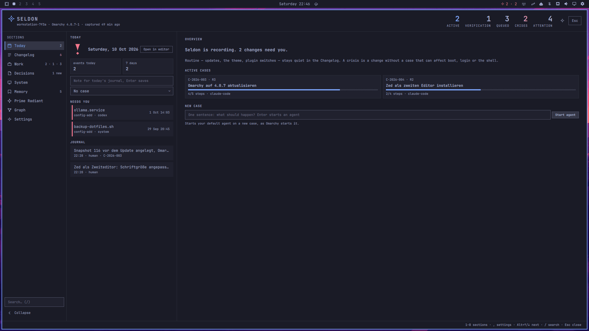

# JAX Seldon

The Omarchy shell plugin for Seldon, the flight recorder and planning desk
for your Omarchy system.

[](https://github.com/JohnAndrewsX/jax-seldon/actions/workflows/ci.yml)
[](https://github.com/JohnAndrewsX/jax-seldon/releases/latest)
[](LICENSE)



*A screenshot of the plugin in a live Omarchy shell on the sample logbook, Tokyo Night theme.*

The Seldon engine records what changes on your machine (packages, Omarchy
updates, themes, plugins, snapshots, config) in a plain-Markdown logbook
and matches it against the changes you planned as cases. This plugin
shows the result in the Omarchy shell. You write notes, plan cases and
explain unexpected changes from the desk; the engine does the writing.

- A pill in the bar counts active cases and crises
  ([The pill](#the-pill)).
- One desk shows today, the changelog, your work cases, decisions, the
  system, your agents' memory, the Prime Radiant's charts and a graph of
  your machine's memory, at the width you choose ([The desk](#the-desk)).
- From the desk you write notes, create cases, move them through their
  steps, hand them to an agent and accept decisions; the engine writes
  each one.
- One form resolves drift: link a change to a case, explain it or
  dismiss it; or let your agent propose it for all open changes and apply
  the proposal yourself.
- Every degraded state, from a missing engine to a stale index, has a
  one-click fix ([States](#states)).

It follows your Omarchy theme, runs every program without a shell and
writes no file itself; only its own settings, through the shell
([Security](#security-privacy-privileges)).

[Install](#install) · [Usage](#usage) · [Keys](#keys) ·
[Configure](#configure) · [Troubleshooting](#troubleshooting) ·
[Remove](#remove) · [Documentation](#documentation)

## Requirements

- Omarchy 4 with the Omarchy shell.
- The `seldon` engine, 0.2.0 or later (see [Install](#install)). Without
  it the desk's setup card offers to install it (see [States](#states)).
- A logbook, created once with `seldon init` (in a terminal; it asks where
  to put it, `~/Seldon` by default), or with the setup card's *Create
  logbook*.

## Install

Three steps: the engine, your logbook, the plugin, all as your user.
No sudo or pkexec is required for these steps.

**1. The engine.** AUR package: coming soon; until then install it from
GitHub. `install.sh` checks the release against its `SHA256SUMS`, refuses
on a mismatch, installs `~/.local/bin/seldon` and never asks for root.
With the GitHub CLI (`gh`) logged in it also verifies the build
provenance (`gh attestation verify`); `--require-verified` refuses an
install without that check.

Download, read, verify, run:

```sh
cd "$(mktemp -d)"
curl -fsSLO https://github.com/JohnAndrewsX/jax-seldon/releases/latest/download/install.sh
curl -fsSLO https://github.com/JohnAndrewsX/jax-seldon/releases/latest/download/SHA256SUMS
less install.sh                                    # read what it does
gh attestation verify install.sh --repo JohnAndrewsX/jax-seldon \
  --signer-workflow JohnAndrewsX/jax-seldon/.github/workflows/release.yml  # optional, needs gh
sha256sum -c --ignore-missing SHA256SUMS && bash install.sh
```

The checksum line checks that `install.sh` matches the release's
`SHA256SUMS`; it does not show who built either. With the GitHub CLI
(`gh`) logged in, the optional `gh attestation verify` line does: it
passes only for a file that this project's release workflow built.
If it fails, do not run `install.sh`. `install.sh` then checks the
engine it downloads. The desk's *Install* button (see
[States](#states)) runs the same script without that first check: it
downloads `install.sh` with `curl` and pipes it to `bash`, in a terminal
you see; `install.sh` still checks the engine.

Run it again to update. Its options (`--version`, `--prefix`, `--unit`
for the optional watcher, `--force` over a self-built `seldon`,
`--require-verified`) are in the
[project README](https://github.com/JohnAndrewsX/jax-seldon#install-options-update-and-removal).
Check the engine with `seldon --version`. If your shell says
`command not found`, open a new terminal.

Once the AUR package is live, you can install the engine from there
instead of GitHub. Install from one source only: both put a `seldon` on
your `PATH`. The AUR package installs through pacman, which asks for
your password.

```sh
omarchy pkg aur add jax-seldon   # install
yay -S jax-seldon                # update
```

**2. Your logbook**, once, in a terminal:

```sh
seldon init
```

It asks one question, where to put the logbook (`~/Seldon` by default),
and takes the defaults for the rest; it records the last 90 days as
history. `seldon doctor` then checks the setup. Or skip this step: the
desk's setup card runs `seldon init --defaults` for you.

**3. The plugin:**

```sh
omarchy plugin add https://github.com/JohnAndrewsX/jax-seldon-plugin.git --enable
```

Omarchy asks before it clones the plugin. The pill lands in the bar's
right section; a left click opens the desk. Without `--enable` the plugin is installed disabled; enable
it later with `omarchy plugin enable jax.seldon`.

**Development copy** (before a release, or to try local changes): copy the
`plugin/` folder of the [project repository](https://github.com/JohnAndrewsX/jax-seldon)
into the plugin directory (a copy, not a symlink: the shell refuses
symlinks in a plugin folder), then enable it and restart the shell:

```sh
mkdir -p ~/.config/omarchy/plugins/jax.seldon
cp -r plugin/. ~/.config/omarchy/plugins/jax.seldon/
omarchy plugin enable jax.seldon
omarchy-restart-shell
```

## Usage

### The pill

The Seldon mark, then `A · D` — A active cases, D crises: changes that can
affect boot, login or the shell and have no case (ADR-0028); zero parts are
hidden (the mark alone, `2`, `· 1`). Other changes without a case are
listed on the desk and never counted in the bar unless you set
`driftInBar` to `all` (see [Configure](#configure)). Accent colour while
cases are active, the theme's urgent colour while a crisis is open (in
every `driftInBar` mode), dimmed while something needs fixing; the mark
takes the same colour, so it follows the theme. The tooltip counts
everything and says when the engine last captured: "Seldon — 2 active
cases, 1 crisis, 7 changes without a case, last capture 4 min ago".

| Click | Does |
|---|---|
| Left | open or close the desk |
| Middle | open the desk at the Prime Radiant |
| Right | capture now (`seldon capture`, then `seldon status`) |

### The desk

One window for everything: it opens over your desktop below the bar, on
the monitor that has the focus, and a click outside it or Esc closes it.
At the top the header: the mark, the machine, the Omarchy version and the
last capture; the **status chip** while a notice is up (the first
notice's title, "+N" for more; a click folds the notices); the counts
active · verification · queued · crises · attention, each a click to its
list; Settings and *Esc*. Under it the notices with their one-click
fixes (see [States](#states)). On the left the sidebar with the nine
sections and their counts and the search (`/`); then the section's list
and the detail of the selected row, its actions in a bar at the top that
stays while the detail scrolls.

The picture at the top of this page shows the desk on Today.

| # | Section | Lists | Actions |
|---|---|---|---|
| 1 | Today | the day's state, events today and in 7 days, the note field (`n`), NEEDS YOU (the crises), today's journal and yesterday's behind one row; the overview: the setup card until Seldon is set up, then "Seldon is recording. …", the active cases as tiles ("agent working" first in its line while an agent runs on one), *New case* from one sentence (`i`) | write a note; *Open in editor* (`e`, today's journal); resolve a crisis in place |
| 2 | Changelog | *Ask agent to sort N changes* and the agent's proposal; the chips open · crisis · attention · routine · in case · all (`f` / `F`); every event, newest first by day, a stripe on open changes (crisis urgent, attention accent) | resolve a change (*Link*, *Explain*, *Dismiss*); *Apply proposals*, *Discard*; *Ask agent*; *Ledger* (`e`); *Capture now* (`c`) |
| 3 | Work | one sentence to a new case and *Run* (`i`); "2 / 3 active" against your limit; *By agent*; *Import tasks…*; *New case* (`+`); the cases grouped ACTIVE · VERIFICATION · QUEUED · COMPLETED, each header with the whole count when the index lists fewer ("QUEUED · 50 / 450") | by status (below); *Open in editor* (`e`); *Ask agent* |
| 4 | Decisions | your decisions (ADRs), newest first, proposed ones marked; the detail shows the decision's first paragraph | *Accept* (twice); *New decision* (`d`); *Open in editor* (`e`) |
| 5 | System | seven tiles: Omarchy, Packages, Snapshots, Deviations, Collectors, Recently edited (files under `~/.config` Seldon does not watch, each with *Watch*), Ignored by pacman; a tile's detail shows its rows and where they come from | *Watch*; *Open in editor* (`e`, the logbook's `STATUS.md`) |
| 6 | Memory | what your agents read at session start: the headings of `memory/lessons.md` and the memory topics | *Open in editor* (`e`, the logbook folder) |
| 7 | Prime Radiant | the charts and the plan (below) | the periods 30 d · 90 d · 365 d · All (`←`/`→`, `h`/`l`) |
| 8 | Graph | areas, cases, decisions and changes of the index as a graph that grows day by day | play the growth (`Space`, `Enter`, `p`), the day (`←`/`→`), fit and zoom (`0`, `-`, `=`), drag, wheel, *Open case* on a node's card |
| `,` | Settings | Appearance (desk width and sidebar), Capture, Agents, Quiet: what is in force and where it is set | the width slider and its presets, the sidebar; the rest is read-only |

Nothing asks for your attention except a crisis: the other changes
without a case wait quietly in the Changelog, and resolving them is up to
you or your agent, never required.

**Writing actions arm first.** A key or a click on an action that writes
arms it; the action bar says so ("Press Enter again"), and the second
press runs it. Any other key disarms. A held key counts as one press;
only the keys that move repeat. A note, a new case from one sentence and
*Reopen* run on the first press. **Enter never starts an agent**: only `a`
or a click on *Hand to agent* does.

**Work.** The cases' actions by status:

| Status | Actions |
|---|---|
| queued | *Start*, *Drop* |
| active | *Hand to agent* (`a`), *To verification*, *Drop* (`x`); while an agent works on the case, *Focus* (`a`) in place of *Hand to agent* |
| verification | *Complete*, *Drop* |
| completed | *Reopen* (`r`) |

*Start*, *To verification*, *Complete* and *Drop* run
`seldon plan start|verify|done|drop <id>`; *Reopen* runs `seldon plan
reopen <id>`, which makes a new active case. *Hand to agent* runs
`seldon agent start <id>`: the engine launches the agent configured in
`~/.config/seldon/config.toml` (`[agent] launcher`) with a prompt that
names the case and the logbook. **The desk steps aside** for what it
opens: after an agent start, an editor or a terminal fix it closes, so
the new window is in front.

**Resolve a change** (Enter on an open change in Today or the
Changelog). The form shows the change (what, who, when, its zone, "crisis"
when it is one, why it is loud, the proposed case, every package of a
transaction) and three ways to resolve it:

| Action | Runs | Afterwards |
|---|---|---|
| *Link* | `seldon drift link <id> <case>` (open cases; the proposed case preselected) | the row says `linked to C-…` |
| *Explain* | `seldon drift explain <id> [--zone] [--risk] [--area] -- <why>` | the engine creates a completed case for it; the row says `explained · C-…` |
| *Dismiss* | `seldon drift dismiss <id> -- <reason>` | the row says `dismissed: <reason>` |

A package transaction resolves as one (*All N*); *Only <package>* resolves
just the row you opened (`--only`). Your text stays until the engine has
resolved the change; if the logbook resolved it already, the form says
"Already resolved: …" and nothing is written.

**Ask agent to sort N changes** (the Changelog's head) asks your default
agent to sort the open changes. Its proposal shows as a row: every item
with the change, the link or explanation and its evidence, evidence by an
agent or of unknown authorship marked. *Apply proposals* applies it as
you in one click, crises never with the rest: each has its own button.
*Discard* throws the proposal away. The agent only proposes; you apply
(ADR-0036). By key: ↑ on the Changelog's first row opens the proposal,
Enter arms *Apply proposals* and a second Enter applies it; ↑ once more
reaches *Ask agent to sort*, and `a` twice starts the agent (Enter never does).

### Keys

The desk's keys (the full table with every section's keys:
[KEYBINDINGS.md](https://github.com/JohnAndrewsX/jax-seldon/blob/main/docs/KEYBINDINGS.md)):

| Key | Does |
|---|---|
| `1`–`8` | Today, Changelog, Work, Decisions, System, Memory, Prime Radiant, Graph |
| `,` | Settings |
| `Alt+↓` / `Alt+↑` | the next / previous section, wrapping |
| `/` | the sidebar search: filters the current list; Enter keeps the filter, Esc clears it |
| ↑ / ↓, `k` / `j` | move in the list; the detail follows. a fresh ↑ at the top of the list (a held one stops there): the notices' buttons (↑/↓ a notice, ←/→ a button, Enter twice runs it, ↓ back) |
| Enter, Space | the detail's first action that launches nothing (arm, then run); on an open change, its form; on a narrow desk, the detail |
| Esc | leave a form, then clear the search, then back to the list (narrow desk), then close |
| `c` | capture now |
| `n` | Today's note field |
| `+` | Work's new case |
| `i` | the one-sentence new case (Today, Work) |
| `e` | open in the editor: the journal, this month's ledger, the case, the decision, `STATUS.md`, the logbook |
| `f` / `F` | Changelog: the next / previous chip |
| ↑ / `k` on the first row | Changelog: the agent's triage proposal; ↓ / `j` its crises (Enter twice applies the one under the cursor alone), then back to the list. On it, Enter twice applies it; ↑ again: *Ask agent to sort*, `a` twice starts it. Today, while Seldon is not set up: the setup card's row; ←/→ a button, Enter twice runs it. Work: the header's buttons (*By agent*, *Import tasks…*, *New case*); ←/→ a button, Enter twice runs it |
| Enter on Appearance | Settings: the width slider, the presets, the sidebar; ↑/↓ a control, ←/→ its value, Enter twice saves it, Esc back |
| `a` | Work: hand the case to the agent (twice), or *Focus* while one works on it |
| `x` | Work: drop the case (twice) |
| `r` | Work: reopen a completed case |
| `d` | Decisions: new decision |

A text field keeps every key while it has the focus; Esc in it gives the
keys back and keeps the text. Tab and Shift-Tab do nothing: the desk is
not a bar popup.

### The Prime Radiant

Section 7 of the desk (`7`, a middle click on the pill, or
`omarchy-shell shell summon jax.seldon '{"section":"radiant"}'`).

- **Periods** (30 d · 90 d · 365 d · All, 90 d each time you enter it;
  `←`/`→` or `h`/`l`) cover the days up to the index's today: 30 d is
  today and the 29 days before it; a drift week counts when any of its
  days does, a case when its span overlaps. *All* is everything the index
  carries.
- **Charts**, in the theme's colours (accent, foreground, urgent):
  - *Heatmap*: events per day as a calendar, weeks as columns, Monday on
    top, five shades of the accent.
  - *Series*: explicit and total package counts as step lines.
  - *DriftBars*: drift opened (accent) and resolved per ISO week.
  - *RiskDonut*: cases by risk R0–R3 (R3 urgent); always all time.
  - *Timeline*: releases, snapshots and crises on top, case spans below
    (open cases run to today).
  - *The Plan*: the active cases as cards with zone, risk, a steps bar and
    the agent; it has no period.
- **Hover:** each chart's title row carries its summary ("62 events on 13
  of 90 days · busiest 2026-10-01 (30)"), replaced by the hovered item's
  details while the pointer is on the chart. A chart without data in the
  period says "no data in this period".

### The graph

Section 8 draws the machine's memory from the index: areas as rings,
cases in the accent, decisions as squares, changes as dots, crises in
the urgent colour. *Play* (`Space`, `Enter` or `p`) grows it from the
first day; `←`/`→` move the day it is cut at. Drag a node or the
background, zoom with the wheel or `-`/`=`, `0` fits the view. A hover
shows a node's card; a case's card has *Open case*.

### States

Until Seldon is set up, Today shows one **setup card** instead of the
setup notices: *Set up Seldon · 2 of 3 steps to go* — install the
engine, create the logbook, read snapshots (optional) — done steps
ticked, the next one with its button; only the optional snapshot grant
asks for your password. After each
step's terminal the card moves on by itself; *Not now* on the snapshot
step ends it for good (Settings › Capture offers it again). The header's
chip shows the same headline and leads to the card. A machine without
snapper has two steps. Once set up, a first-day card says "Seldon is
recording. Nothing to do."

When something else is wrong the desk shows a notice under the header,
with its one-click fix, and the header's chip names it; the setup states
below are the setup card's steps:

| State | Banner | One-click fix |
|---|---|---|
| Engine missing | Install the engine (step 1 of the setup card); Seldon engine missing, in the urgent tone, when an index shows the engine was there before | *Install* opens a floating terminal that says what it does, shows the GitHub one-liner `curl -fsSL https://github.com/JohnAndrewsX/jax-seldon/releases/latest/download/install.sh \| bash`, runs it (the script verifies the engine it downloads against `SHA256SUMS`; see [Install](#install)) and says whether the engine is installed; the desk then finds it by itself; *Copy* puts the one-liner on the clipboard; *Check again* (on the urgent notice) looks for the engine again |
| Logbook not initialised | Create the logbook, step 2 of the setup card, with what the machine remembers without Seldon (the card stands in for the notice "Create your logbook") | *Create logbook* opens a terminal that says what happens, shows and runs `seldon init --defaults` (no question: `~/Seldon`, the last 90 days recorded as history "before Seldon"), then says whether the logbook was created; the desk then updates by itself; *Copy*; *Check again*; when the folder already holds other files, *Choose a folder* runs `seldon init`, which asks where |
| Index missing | No index yet / Index unreadable (also an `index.json` of 1 MB or more, which the plugin does not parse: "index.json is 1.2 MB, over the 1 MB the plugin reads; …"; the engine keeps it below that by leaving out the oldest rows, an older engine may not) | *Build index* runs `seldon status`, which writes it |
| Index stale (older than 2 h) | Index is stale | *Capture now* |
| Index format mismatch | Index format mismatch, with both contract versions | *Update* / *Copy*: `omarchy plugin update jax.seldon` when the plugin is older (then restart the shell, see [Update](#update)), the GitHub one-liner from *Engine missing* again when the engine is older (until the AUR package is live, ADR-0024) |
| Engine newer than the plugin (an index of a newer contract that says this plugin can read it, ADR-0051) | The engine is newer than the plugin: "The engine writes index vN; this plugin reads v2 — update the plugin.", in the neutral tone; no status notice, the pill keeps its counts and colour | *Update* / *Copy*: `omarchy plugin update jax.seldon` (then restart the shell, see [Update](#update)) |
| Engine too old (older than the plugin's `engineMin`) | Engine too old, with the version the plugin needs and the one `seldon` reports | *Update* runs the GitHub one-liner from *Engine missing* in a terminal (until the AUR package is live, ADR-0024); *Copy*; *Check again* looks for the engine again |
| Snapshots not readable | Read snapshots (optional), step 3 of the setup card: one sentence on the one-time grant; what the grant gives: read access to the snapshot directory listing and the snapshot info files (files inside a snapshot keep their own permissions), no snapshot creation, change or deletion (ADR-0026) | *Grant* opens a terminal that says what the grant does and that it asks for your password once, shows and runs `sudo setfacl -m u:$USER:rx /.snapshots`, then runs `seldon capture` and says "Snapshots are now recorded" (or, if that capture did not run, that the snapshots were not recorded yet); the card moves on by itself (Seldon never runs the grant on its own). *Copy* copies the command; *Check again* runs a capture, like *Capture now*, for a grant you ran yourself; *Not now* (on the card) puts the step away for good |
| Plugin updated, shell not restarted (the installed manifest names another version than the code running) | Restart the shell to finish the update, in the neutral tone above the other notices, with both versions | *Restart shell* runs `omarchy-restart-shell`, no arguments; the shell then loads the installed plugin |
| Capture warned (a capture the plugin ran exited 0 with warnings) | Capture warned, in the neutral tone under the other notices: the first line of each warning as the engine wrote it (today the state reset and its restore hint, WP-081); the full text on hover | None: the warning names the user guide section to read. The notice stays until a capture the plugin runs (*Capture now*, *Check again*, the `c` key, the bar's right click, the timer) finishes without warnings; a failed or locked capture leaves it |

The engine is looked for when the shell starts, when the desk opens
while it is missing, every few seconds for ten minutes after an *Install*
terminal, and on *Check again* (or `omarchy-shell jax.seldon.service
refresh`), not on every capture.

## Configure

**Settings** (the desk's Settings › Appearance for the width and the
sidebar; all of them in Omarchy's bar settings, Setup > Plugins >
Seldon, or with `omarchy bar set`):

| Key | Default | What it does |
|---|---|---|
| `captureIntervalMin` | `15` | How often (5–120 minutes) the engine captures system changes while the shell runs |
| `wipLimit` | `3` | Work shows active cases against this limit ("2 / 3 active"); 1–20; it warns, it never blocks. Cases in verification do not count |
| `driftInBar` | `crisis` | What the bar's second number counts: `crisis` (changes that can affect boot, login or the shell and have no case), `all` (every change without a case, as before 0.1.4) or `none` (no number). The urgent colour on a crisis stays in every mode |
| `deskWidth` | `100` | How wide the desk opens, 50–100 % of the screen's width between Omarchy's outer gaps; never narrower than 960 px unless the screen is. Settings › Appearance has a slider and the presets 50 %, 67 %, 75 % and Full |
| `deskSidebar` | `open` | `open`: the sections with names and counts; `collapsed`: icons only (the fold button at the sidebar's foot switches it). A desk narrower than 960 px always shows icons only, and under 760 px the list and the detail stack |

```sh
omarchy bar set jax.seldon captureIntervalMin 30 --json
omarchy bar set jax.seldon driftInBar all
omarchy bar set jax.seldon deskWidth 67
omarchy bar move jax.seldon --section right
```

**Suggested binding** (not installed by the plugin). Add it to your
Hyprland bindings (`~/.config/hypr/bindings.lua`); Omarchy leaves
Super+Shift+L (L for logbook) free:

```
o.bind("SUPER + SHIFT + L", "Seldon", "omarchy-shell shell toggle jax.seldon")
```

**IPC targets:**

| Command | Reaches |
|---|---|
| `omarchy-shell shell toggle jax.seldon` | open or close the desk (also `summon`, `hide`) |
| `omarchy-shell shell summon jax.seldon '{"section":"work"}'` | open the desk at a section (`today`, `changelog`, `work`, `decisions`, `system`, `memory`, `radiant`, `graph`, `settings`); `"select":"<id>"` selects an item, `"filter":"crisis"` a Changelog chip, `"period":"30"` opens the Prime Radiant on a period |
| `omarchy-shell shell call jax.seldon view ""` | what the open desk shows, as JSON |
| `omarchy-shell shell call jax.seldon section <id>` | show a section of the open desk |
| `omarchy-shell shell call jax.seldon select <id>` | select an item of the current section; `notices`, `setup`, `ask`, `header`, `width`, … put the keys on a button without pressing it |
| `omarchy-shell shell call jax.seldon setPeriod 30` | show the Prime Radiant on a period (`30`, `90`, `365`, `all`) |
| `omarchy-shell shell call jax.seldon hover "series 0.5,0.5"` | the read-out at that point of a Prime Radiant chart (`heatmap`, `series`, `driftBars`, `riskDonut`, `timeline`, `plan`; x,y as fractions of its plot), as JSON, while section 7 is shown; `hover ""` clears; a malformed argument returns `{"error": …}` and changes nothing |
| `omarchy-shell jax.seldon.panel open\|close\|toggle\|show\|hide\|tab <name>\|resolve crisis\|proposal\|<event id>\|filter <source>\|view\|pill` | the 0.1 panel's target, forwarded to the desk; a later release removes it (the CHANGELOG announces it under Breaking) |
| `omarchy-shell jax.seldon.service status` | the service state, as JSON |
| `omarchy-shell jax.seldon.service refresh` | look for the engine again and re-read the index |
| `omarchy-shell jax.seldon.service capture` | capture now |

## Security, privacy, privileges

The plugin runs **unsandboxed inside the Omarchy shell process**, like every
shell plugin. This is everything it does outside its own window:

- **Reads one file:** `${XDG_STATE_HOME:-~/.local/state}/seldon/index.json`,
  which the engine writes (or the file `SELDON_INDEX` names, see
  [Development](#development)). The contract would let it read the files
  the index points to; this version reads none of them and asks the engine
  to open them in your editor instead. Everything shown from the index is
  displayed as plain text, never evaluated.
- **Runs the `seldon` engine only with these fixed argument lists**
  (the project's `docs/CONTRACT.md`, "Commands the plugin may run"):

  ```
  seldon --version --json
  seldon status --json
  seldon capture --all --json --quiet
  seldon log [--case <id>] --json -- <text>
  seldon open <journal|ledger|status|logbook|caseId|ADR-NNNN> --editor --json
  seldon plan new --zone <z> --risk <r> [--area <slug>] [--priority <p>] --json -- <title>
  seldon plan start|verify|done|drop <id> --json
  seldon plan reopen <caseId> --json
  seldon plan show <caseId> --json
  seldon agent start <caseId> --json
  seldon agent start --new --json -- <intent>
  seldon agent focus <caseId> --json
  seldon agent sessions --json
  seldon agent ask triage --json
  seldon agent ask drift|case <id> --json
  seldon import task --json [--dry-run] [--area <slug>] -- <path>
  seldon drift link <eventId> <caseId> [--only] --json
  seldon drift explain <eventId> [--only] [--zone <z>] [--risk <r>] [--area <slug>] --json -- <text>
  seldon drift dismiss <eventId> [--only] --json -- <reason>
  seldon drift show <eventId> --json
  seldon drift apply <proposalId> [--item <eventId>]… --json
  seldon drift discard <proposalId> --json
  seldon decide --no-edit --json -- <title>
  seldon decide accept <ADR-NNNN> --json
  seldon preview --json
  seldon doctor --only rules --json
  seldon rules update --json
  seldon config watch --json -- <path>
  seldon rebuild --json
  seldon update-impact --json
  ```

  `rebuild` and `update-impact` are allowed but not issued by this version.
  Every call goes through one check that refuses any argument list not on
  this list. Ids (case, event, decision, proposal, also the one the
  engine reports for a decision it just created) must match their schema
  pattern; zone, risk, priority and area must be known values or a slug;
  free text (a note, a title, an intent, an explanation, a reason) and a
  path are exactly one non-empty argument after `--`, without NUL
  characters. The plugin never runs `seldon drift propose`: proposing is
  the agent's command, applying is yours.
- **When it runs the engine:** `seldon --version --json` at shell start,
  when the desk opens while the engine is missing and on *Check again*;
  `seldon capture` then `seldon status` at start and every capture
  interval; the read-only `seldon agent sessions`, `seldon doctor --only
  rules` and (before the logbook exists) `seldon preview` while the desk
  is open; everything else only on your click or key press.
  `seldon open` makes the engine start your editor, and
  `seldon agent start` and `seldon agent ask` make it start the agent
  launcher you configured in `~/.config/seldon/config.toml`; those are the
  engine's actions, under your configuration.
- **Two other programs, only when you click a banner button:**
  `wl-copy -- <command>` (*Copy*) and
  `omarchy-launch-floating-terminal-with-presentation <script>`
  (*Install*, *Create logbook*, *Choose a folder*, *Grant*, *Update*).
  `<script>` is one of six constant scripts in the plugin, one per
  command: a `gum style` line that
  says what happens, the command shown, the command run, and a line that
  says what changed (or, on Ctrl+C, "Cancelled", and the window closes);
  nothing from the index or the logbook is in them.
  `<command>` is always one of these constants:
  `curl -fsSL https://github.com/JohnAndrewsX/jax-seldon/releases/latest/download/install.sh | bash`
  (the engine install while the AUR package does not exist; it fetches
  the script over TLS from this project's release and the script checks
  the engine against `SHA256SUMS`; the engine install and the engine
  update), `seldon init --defaults`, `seldon init`,
  `omarchy plugin update jax.seldon`,
  `sudo setfacl -m u:$USER:rx /.snapshots`.
  Omarchy's launcher runs the script in a terminal window you see
  (`sudo` asks for your password there). After the snapshot grant the
  script runs `seldon capture`, after the engine update `seldon status`,
  so the index shows the change.
- **One more, only on *Restart shell*:** `omarchy-restart-shell`, with no
  arguments, from the notice that shows after a plugin update while the
  shell still runs the old code. It reads the plugin's own `manifest.json`
  as the shell hands it over (its `version`), nothing else.
- **Never shell strings:** every program is started with an argument list,
  without a shell. Nothing from the index or the logbook ever becomes part
  of a command line other than as one validated argument.
- **Writes nothing itself.** Notes, cases, drift resolutions and decisions
  are written by the engine, into your logbook, on your Enter or click.
  The one thing the plugin changes is its own settings: the desk's width
  and sidebar (Settings › Appearance, or the sidebar's fold button) are
  stored by Omarchy's shell in the plugin's own entry of
  `~/.config/omarchy/shell.json`, through the shell's plugin interface,
  once per click or slider release (a scroll over the slider writes once,
  after it stops) — the same entry Omarchy's bar settings edit. No other
  setting in that file changes; as with Omarchy's own bar settings, the
  shell writes the whole file back in its own formatting (indentation,
  key order), so hand formatting there is normalised.
- **No network.** No sockets, no downloads, no update checks. The one
  exception is yours to click: *Install* on the setup card or the
  engine-missing notice runs the `curl … | bash` install in a terminal
  you see.
- **No units, binaries or installers.** The plugin folder holds QML,
  JavaScript, this README, the licence, the manifest and the preview
  image; no
  services, timers, scripts or symlinks. The engine is installed
  separately (`install.sh` from the GitHub release, or the AUR package);
  the plugin never installs it.
- **Privileges.** The plugin runs as your user.
  No sudo or pkexec is required to use it.
  One button asks for your password, and only when you press it: the
  optional snapshot grant (*Grant* on the setup card or the snapshot
  notice, above) runs
  `sudo setfacl -m u:$USER:rx /.snapshots` in a terminal you see
  (ADR-0026). Outside the plugin, installing, updating or removing the
  engine's AUR package asks too, because pacman runs through sudo
  (`omarchy pkg drop` runs `sudo pacman -Rns`; see [Install](#install)
  and [Remove](#remove)).
- **Dev mode is read-only:** with `SELDON_INDEX` set, the plugin only
  probes `seldon --version --json`; it never runs capture, status or any
  writing command.

## Troubleshooting

| Symptom | Try |
|---|---|
| No pill in the bar | `omarchy plugin list` (is `jax.seldon` there and enabled?), `omarchy plugin enable jax.seldon`, `omarchy bar move jax.seldon --section right` |
| A notice or the setup card instead of data | its button is the fix; see [States](#states) |
| The panel's install button runs `omarchy pkg aur add jax-seldon`, which fails | that is plugin 0.1.0: its button points to an AUR package that does not exist yet. Update the plugin first, `omarchy plugin update jax.seldon` (Omarchy shows the changes and asks `Update jax.seldon?`; answer yes), then `omarchy-restart-shell`; the desk installs the engine from the GitHub release |
| After an update the pill still opens the old panel | the shell runs the old plugin code until it restarts: `omarchy-restart-shell` (the restart notice says the same); see [Update](#update) |
| "Index format mismatch" after an update | engine and plugin are a different contract: update the other one too (0.2.0 needs engine and plugin 0.2.0); the notice's *Update* does it |
| The desk is too wide or too narrow | Settings (`,`) › Appearance, or `omarchy bar set jax.seldon deskWidth 67`; see [Configure](#configure) |
| An action says the index is behind your logbook | you changed the logbook elsewhere (a terminal); *Capture now* or `seldon status`, then try again |
| Changes to plugin files do not show, or an update does not | `omarchy-restart-shell` (the shell caches plugin components; see [Update](#update)) |
| What does the plugin see? | `omarchy-shell jax.seldon.service status`, and while the desk is open `omarchy-shell shell call jax.seldon view ""`, print it as JSON |
| The engine refuses something | run the same command with `seldon … --json` in a terminal for the full message; the engine's own docs are in the project repository |

Plugin warnings go to the shell's log: `journalctl --user -t omarchy-shell`.

## Update

```sh
omarchy plugin update jax.seldon
omarchy-restart-shell
```

The update fetches the new plugin files and asks the shell to reload its
plugins, but the shell keeps running the plugin code it loaded first
until it restarts. `omarchy-restart-shell` restarts the bar, panels and
overlays; your applications keep running. It refuses while the screen
is locked. When the plugin sees that the installed plugin is not the one
running, the desk says so (see [States](#states)); a plugin version that
does not know this notice yet shows nothing, so restart after every
update.

**From 0.1.x to 0.2.0** update the engine and the plugin together: 0.2.0
reads and writes index contract 2, and a 0.1.x plugin or engine shows
"Index format mismatch" against it. The bar popup and the fullscreen
Prime Radiant are replaced by the desk; the pill and its counts stay, and
the `jax.seldon.panel` IPC target still forwards to the desk. Your
settings keep their values; `deskWidth` and `deskSidebar` start at their
defaults (100 %, open). The digits `1`–`8` are the desk's sections now;
the Prime Radiant's periods moved to `←`/`→` and `h`/`l`.

## Remove

```sh
omarchy plugin remove jax.seldon
```

This removes the plugin only. The engine, your logbook (`~/Seldon` unless
you chose another place) and the index under `~/.local/state/seldon/`
stay. To remove the engine as well, installed from GitHub, run
`install.sh` with `--uninstall`. No copy left? Download, read and verify
it as under [Install](#install):

```sh
cd "$(mktemp -d)"
curl -fsSLO https://github.com/JohnAndrewsX/jax-seldon/releases/latest/download/install.sh
curl -fsSLO https://github.com/JohnAndrewsX/jax-seldon/releases/latest/download/SHA256SUMS
less install.sh                                    # read what it does
gh attestation verify install.sh --repo JohnAndrewsX/jax-seldon \
  --signer-workflow JohnAndrewsX/jax-seldon/.github/workflows/release.yml  # optional, needs gh
sha256sum -c --ignore-missing SHA256SUMS && bash install.sh --uninstall
```

It removes exactly the files `install.sh` installed (add the same
`--prefix` if you gave one). Installed from the AUR:

```sh
omarchy pkg drop jax-seldon
```

It runs `sudo pacman -Rns`, so it asks for your password (or use your AUR
helper: `yay -R jax-seldon`). Your logbook is yours: Seldon never deletes
it.

## Development

- `SELDON_INDEX=/path/to/index.json` makes the service read that file
  instead (relative paths resolve against the shell's working directory).
  Dev mode is read-only: the engine is probed, never run.
- `SELDON_NOW=<RFC 3339>` (with `SELDON_INDEX`) sets the clock for the
  staleness check; without it a fixture never turns stale.
- After changing plugin code, restart the shell (`omarchy-restart-shell`).
- Tests, the headless harnesses and how `preview.png` is made:
  [`docs/TESTING.md`](https://github.com/JohnAndrewsX/jax-seldon/blob/main/docs/TESTING.md).

## Documentation

| You want to | Read |
|---|---|
| Use Seldon, engine and plugin together | User guide: [English](https://github.com/JohnAndrewsX/jax-seldon/blob/main/docs/user/en/README.md) · [Deutsch](https://github.com/JohnAndrewsX/jax-seldon/blob/main/docs/user/de/README.md) |
| Get going in fifteen minutes | [Getting started](https://github.com/JohnAndrewsX/jax-seldon/blob/main/docs/user/en/01-getting-started.md) · [Erste Schritte](https://github.com/JohnAndrewsX/jax-seldon/blob/main/docs/user/de/01-getting-started.md) |
| Let an AI agent work in your logbook | [Agent guide](https://github.com/JohnAndrewsX/jax-seldon/blob/main/docs/AGENT-GUIDE.md) · [`llms.txt`](https://github.com/JohnAndrewsX/jax-seldon/blob/main/llms.txt) |
| Read what the plugin may do | [Plugin spec](https://github.com/JohnAndrewsX/jax-seldon/blob/main/docs/SPEC-PLUGIN.md) · [Contract](https://github.com/JohnAndrewsX/jax-seldon/blob/main/docs/CONTRACT.md) |
| See what changed | [Changelog](https://github.com/JohnAndrewsX/jax-seldon/blob/main/CHANGELOG.md) |

The plugin only reads Seldon's index; agents work through the engine. An
agent started inside a Seldon logbook follows that logbook's `AGENTS.md`;
the agent guide is its long form.

## Project home, contributing and licence

Project home, issues and the engine:
<https://github.com/JohnAndrewsX/jax-seldon>. This plugin repository is
generated from its `plugin/` folder; please file issues and pull requests
there, following its
[contributing guide](https://github.com/JohnAndrewsX/jax-seldon/blob/main/CONTRIBUTING.md).
Report a vulnerability privately, never in a public issue: see
[`SECURITY.md`](SECURITY.md).

MIT, see [`LICENSE`](LICENSE).
